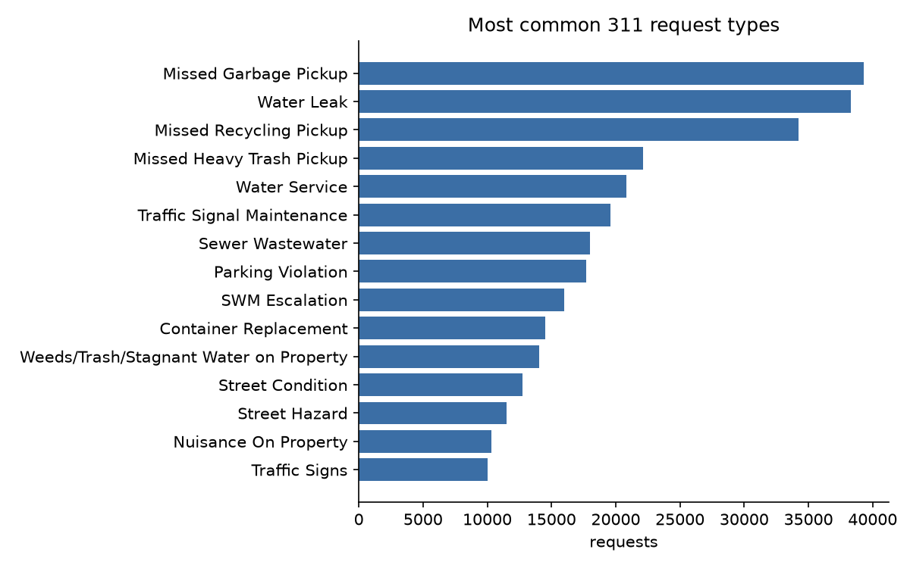

# Houston 311 Resolution Predictor

Predicts whether a Houston 311 service request (potholes, water leaks, missed trash pickup, ...)
will be **closed late**, using only information available when the request is created.

The pipeline downloads the City of Houston's official 311 extracts (~380 MB for 2025), cleans
them with SQL in DuckDB, explores what drives delays, and compares baseline machine-learning models.

> **Status:** first full run on 2025 data complete (see Results). Next: dashboard and Azure deployment.

## Pipeline

```
houstontx.gov 311 extracts ─▶ src/download.py ─▶ data/raw/*.txt
                                                    │
                          sql/01_clean.sql ◀── src/load_db.py ─▶ DuckDB `requests` table
                                                    │
                       sql/02_eda.sql ◀── src/eda.py ─▶ reports/*.csv, *.png
                                                    │
                              src/train_baseline.py ─▶ reports/metrics.json, roc_curves.png
```

| Step | What it does |
| --- | --- |
| `download.py` | Streams the yearly pipe-separated extracts listed in `config.yaml` to `data/raw/` |
| `load_db.py` | Skips the file banner, keeps only needed columns, converts all times to UTC, loads into DuckDB, runs the cleaning SQL |
| `01_clean.sql` | Types and dedupes records, drops impossible rows, computes resolution time and the `is_overdue` label |
| `02_eda.sql` | Volume, delay rate and median days to close by request type, department, district, month and channel |
| `train_baseline.py` | Time-based split (train on older requests, test on newest), compares a majority baseline, logistic regression and gradient boosting, reports ROC-AUC / F1 / precision / recall, and ranks features by permutation importance |

**Target (`is_overdue`):** finished after the city's `Resolve By Time` (due date). Requests still open
past their due date count as late; requests still open and not yet due are left out.

**Data notes (checked against real rows, Oct 2026):**
- `Created Date UTC` and `Resolve By Time` are in UTC; `Closed Date` is Houston local time, so it is
  converted to UTC before computing durations.
- A small share of `Routed` requests carry a closed date even though the work isn't finished. Those
  closed dates are ignored (`not_finished_statuses` in `config.yaml`).
- Free-text notes at the end of each row can contain `|`, so rows are split only up to the last needed column.

**No data leakage:** the model only uses fields known at creation time (request title and type,
department, division, channel, council district, SLA length, day of week, hour, month).

## Quick start

```bash
python -m venv .venv && source .venv/bin/activate   # Windows: .venv\Scripts\activate
pip install -r requirements.txt

python src/download.py --peek            # 1. check the files are reachable and see their header
python src/download.py                   # 2. download 2025 (~380 MB, a few minutes)
python src/load_db.py                    # 3. clean with SQL into DuckDB
python src/eda.py                        # 4. tables + charts in reports/
python src/train_baseline.py             # 5. train and compare models
```

### Testing without the real data

`tests/make_sample.py` creates a small **synthetic** file in the exact city format so you can check that everything runs.
It is fake data — never report its results.

```bash
python tests/make_sample.py
python src/load_db.py --files data/sample/houston_311_sample.txt
python src/eda.py && python src/train_baseline.py
```

## Results

**Data:** 445,423 Houston 311 requests created in 2025 (city export of Oct 28, 2026).
93.2% closed, median 5.7 days to close, **41.5% finished after their due date**.
410,923 requests have a due date and are used for modeling.

### Model performance (test set: newest 82,185 requests, Oct 7 - Dec 31, 2025)

| Model | ROC-AUC | Accuracy | Precision | Recall | F1 |
| --- | --- | --- | --- | --- | --- |
| Baseline (always "on time") | 0.50 | 58.6% | - | 0% | - |
| Logistic regression | 0.79 | 65.6% | 55.2% | 88.8% | 0.68 |
| **Gradient boosting** | **0.81** | **72.6%** | **63.8%** | **78.1%** | **0.70** |

**Request type drives almost everything.** Shuffling `case_type` drops ROC-AUC by 0.31; every
other feature drops it by less than 0.01. (Title and department show ~0 because they carry the
same information as case type - shuffle one and the model leans on the others.)

### What the data shows

**Solid Waste Management is where delays concentrate.** It handles 43% of requests but finishes
61% of them late, versus 27% for Public Works, which handles a similar volume.

| Department | Requests | Median days | Late |
| --- | --- | --- | --- |
| Public Works | 204,551 | 1.4 | 26.7% |
| Solid Waste Management | 192,295 | 12.1 | 61.2% |
| Parking Management | 18,552 | 9.2 | 7.5% |
| Neighborhoods | 13,996 | 161.1 | 33.8% |
| Parks and Recreation | 9,329 | 21.9 | 51.3% |
| Health | 5,168 | 6.8 | 0.8% |

**Most-late request types** (all Solid Waste): SWM Escalation 92.9%, Container Replacement 73.9%,
Missed Heavy Trash Pickup 69.3%, Missed Recycling Pickup 66.1%. A missed recycling pickup is late
far more often than a missed garbage pickup (66.1% vs 40.3%).

**Most on-time:** Parking Violation 5.2%, Street Condition 9.7%, Water Service 11.7%,
Traffic Signs 11.8%.

**Slow is not the same as late.** Weeds/Trash/Stagnant Water on Property takes a median of 200 days
and Nuisance On Property 182 days, yet only about half are late - these inspection cases have long
deadlines. Lateness measures whether a deadline is met, so a type that is late most of the time
may have a deadline that doesn't match how the work is done.



## Next steps

- [ ] Power BI or Streamlit dashboard of the EDA tables
- [ ] Add weather and holiday features
- [ ] Move storage to Azure (Blob Storage + Azure SQL) and schedule with Data Factory
- [ ] One-page findings memo

## Data source

City of Houston, [311 Service Request Data](https://houstontx.gov/311/servicerequestdata.html) —
yearly pipe-separated extracts, updated monthly. Data is public; check the city's terms before
redistributing it.